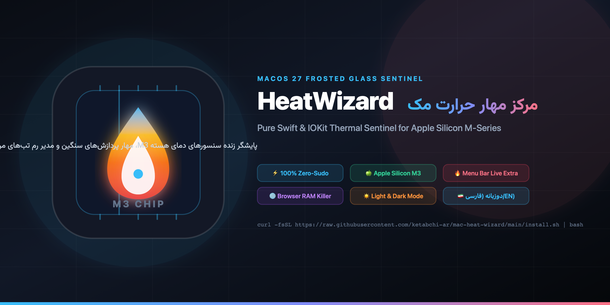

<div align="center">



# HeatWizard (مک هیت‌ویزارد)
### 🍏 Apple Silicon M3/M2/M1 Thermal Sentinel & Resource Guardian
**A native macOS frosted-glass thermal monitor, browser tab RAM manager, and spike-hunting daemon built with pure Swift & IOKit. Zero root required.**

<p align="center">
  
  
  
  
  
  
</p>

[**English Guide**](#-english-overview) • [**راهنمای فارسی**](#-راهنمای-جامع-فارسی) • [**Installation**](#-quick-installation) • [**Architecture**](#-architecture)

</div>

---

## ⚡️ English Overview

**HeatWizard** is an ultra-lightweight, zero-overhead thermal supervisor engineered specifically for Apple Silicon Macs (M1, M2, M3 family). It monitors hardware temperature sensors directly via `IOKit` C-APIs without requiring `sudo` privileges or polling heavy tools like `powermetrics`.

When your MacBook starts running hot or fans ramp up, HeatWizard instantly diagnoses the culprit (such as corrupt Finder icon caches, runaway Chrome renderers, or charging heat dissipation) and gives you one-click remedies.

### ✨ Key Capabilities

- **🌡 Direct Silicon Telemetry (Zero Sudo):** Reads temperature across all 45+ Apple Silicon M-series sensors through private `IOHIDEventSystemClient` bindings in under 1ms.
- **📈 Live Core Waveform:** Smooth real-time Bezier sparkline graphing temperature history with glowing neon indicators.
- **🔥 Top Menu Bar Extra:** Persistent live status item displaying real-time chip temperature (e.g. `🔥 44°C`) and quick-access utility shortcuts.
- **🌐 Browser RAM Tab Inspector:** Automatically scans open tabs across **Google Chrome** and **Brave Browser**, ranks them by allocated RAM (MB), and provides a one-click **Close Tab (`✕`)** button.
- **⏸ Process Freezing (`SIGSTOP` / `SIGCONT`):** Freeze runaway browser tabs or background processes without losing tab state or open work.
- **🔔 Background Sentinel Daemon:** Low-footprint `launchd` background monitor that records thermal spikes to `~/.mac_heat_history.log` and dispatches native macOS alert banners when thresholds are breached.
- **☀️ Light & Dark Themes:** Dual aesthetic styles matching macOS Dark Titanium and macOS 27 Liquid Glass White.
- **🇮🇷 Full Bilingual Support:** One-click toggle between Persian (RTL with Vazirmatn font) and English (LTR).

---

## 🚀 Quick Installation

### 1-Line Automatic Install
Run the installer directly from your terminal:

```bash
git clone https://github.com/ketabchi-ar/mac-heat-wizard.git ~/mac-heat-wizard
cd ~/mac-heat-wizard
./install.sh
```

### What this does:
1. Compiles the native Swift binary with `-O` compiler optimizations.
2. Installs `HeatWizard.app` into `~/Applications/`.
3. Registers the background monitoring daemon via `launchctl` (`com.ardalan.heat-monitor`).
4. Symlinks CLI helpers (`mac-heat`, `mac-heat-wizard`, `mac-heat-scan`) to `~/.local/bin`.

---

## 🛠 Usage & Shortcuts

### Launching the App
- **From Menu Bar:** Click the `🔥` icon next to the clock in the top macOS menu bar.
- **From Spotlight:** Press `Cmd + Space` and search `HeatWizard`.
- **From Terminal:**
  ```bash
  mac-heat        # Opens the graphical control center
  mac-heat-scan   # Fast CLI terminal heat snapshot
  ```

### Closing the App
- Press `Cmd + Q` on the window.
- Or click the `🔥` icon in the menu bar and select **خروج (Quit)**.

---

## 🏗 Architecture

```
mac-heat-wizard/
├── assets/                  # High-res logos, banner, AppIcon (.icns)
├── src/
│   ├── HeatWizard/
│   │   ├── main.swift       # Pure Swift backend, IOKit telemetry, Cocoa window & Menu Bar
│   │   └── Resources/
│   │       ├── index.html   # Frosted-glass WebKit frontend (Vazirmatn UI, Bezier Canvas)
│   │       ├── Info.plist   # macOS application metadata & bundle identifiers
│   │       └── BurningIcon.icns
│   ├── daemon/
│   │   ├── mac-heat-daemon.py             # launchd background thermal watcher
│   │   └── com.ardalan.heat-monitor.plist # launchd agent definition
│   └── cli/
│       ├── mac-heat         # Quick launcher
│       └── mac-heat-scan    # Lightweight shell diagnostic script
├── build.sh                 # One-command compile script
├── install.sh               # Complete installer
├── uninstall.sh             # Complete uninstaller
└── LICENSE                  # MIT License
```

---

<div dir="rtl">

## 🇮🇷 راهنمای جامع فارسی

### هیت‌ویزارد چیست؟
**هیت‌ویزارد (HeatWizard)** ابزار بومی، شیک و فوق‌العاده سبک مک برای پایش و مهار حرارت پردازنده‌های **Apple Silicon (چیپست‌های M1 / M2 / M3)** است. این برنامه بدون نیاز به دسترسی ادمین (`sudo`) و با استفاده مستقیم از APIهای سطح پایین `IOKit` سیستم‌عامل، دمای بیش از ۴۵ سنسور حرارتی هسته‌های پردازنده را با سرعت کمتر از ۱ میلی‌ثانیه خوانده و علت داغی مک شما را ریشه‌یابی می‌کند.

### 🌟 ویژگی‌های برجسته:
1. **پایش مستقیم دمای پردازنده M3 بدون نیاز به روت:** خواندن سریع دمای هسته‌ها از سنسورهای HID اپل بدون هیچ افت پرفورمنسی.
2. **آیکون زنده در منوبار بالای مک:** نمایش دائمی دمای چیپست کنار ساعت (مثل `🔥 44°C`) به همراه دسترسی سریع به ابزارهای سیستمی.
3. **مدیریت رم تب‌های مرورگر (Chrome و Brave):** فهرست‌بندی خودکار تب‌های باز، مرتب‌سازی بر اساس بیشترین مصرف RAM، و امکان بستن تکی هر تب سنگین با دکمه **`✕ بستن`**.
4. **فریز موقت تب‌ها و پردازش‌ها (`SIGSTOP` / `SIGCONT`):** متوقف‌سازی مصرف پردازنده تب‌های سنگین بدون از بین رفتن اطلاعات آن‌ها.
5. **دیمن هوشمند پس‌زمینه (Daemon):** ثبت خودکار تاریخچه جهش‌های حرارتی در `~/.mac_heat_history.log` و ارسال نوتیفیکیشن در صورت عبور از آستانه مجاز.
6. **دوزبانه کامل (فارسی / انگلیسی):** سوییچ آنی زبان و تغییر خودکار جهت چینش (RTL / LTR) با فونت استاندارد وزیرمتن.
7. **طراحی شیشه‌ای با تم دارک و لایت:** پشتیبانی از سبک شیشه‌ای Frosted Glass و سوییچ بین تم تیره و روشن.

### 📥 نحوه نصب سریع
کافیست دستور زیر را در ترمینال مک اجرا کنید:

```bash
git clone https://github.com/ketabchi-ar/mac-heat-wizard.git ~/mac-heat-wizard
cd ~/mac-heat-wizard
./install.sh
```

### ⌨️ دستورات خط فرمان:
- `mac-heat`: باز کردن پنجره کنترل حرارتی
- `mac-heat-scan`: گزارش سریع و متنی حرارت و بار سیستم در ترمینال

---

</div>

## 📄 License

This project is licensed under the **MIT License** — see the [LICENSE](LICENSE) file for details.

Developed with ❤️ for the Apple Silicon community by **[Ardalan Ketabchi](https://github.com/ketabchi-ar)**.
